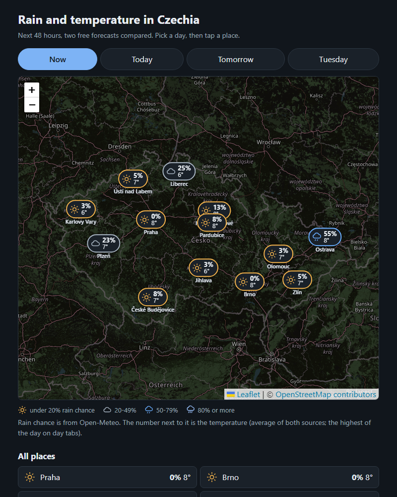
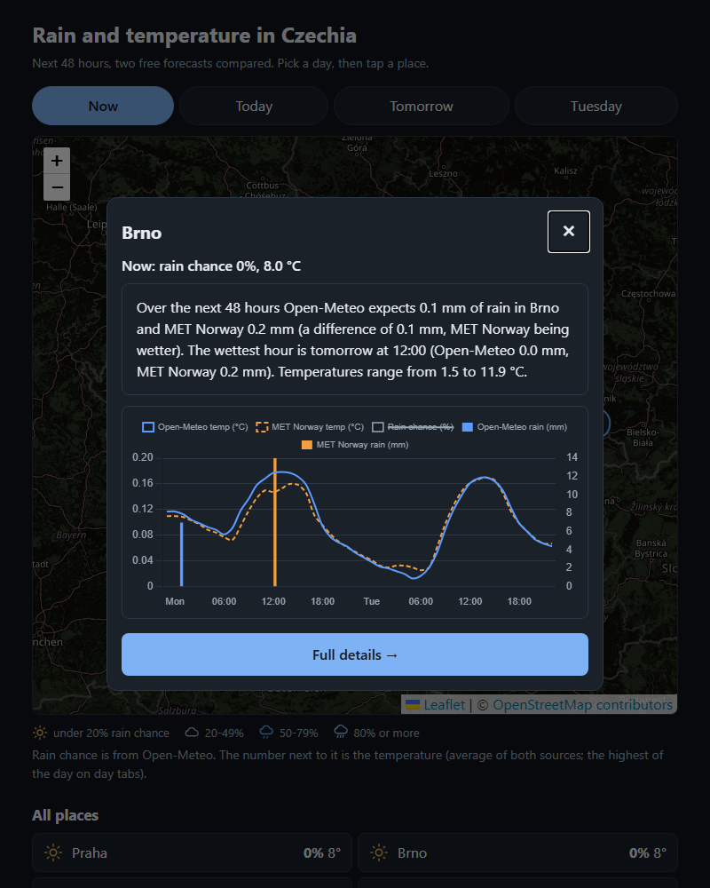
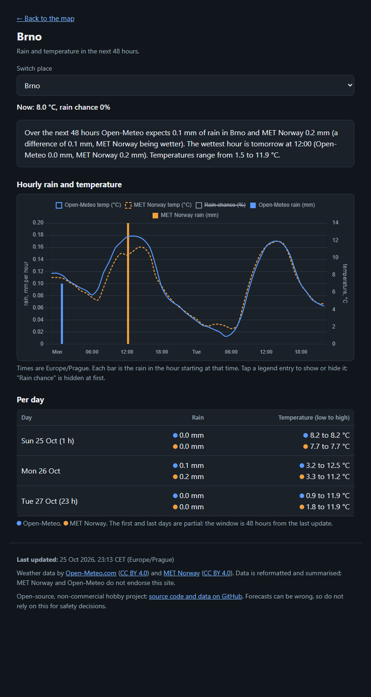
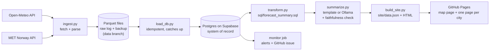

# rain-forecast-cz

**A small, fully static website with a map of Czechia that shows the rain chance and temperature for the 13 regional capitals over the next 48 hours, putting two free forecasts (Open-Meteo and MET Norway) side by side. Tap a city for a quick view with a short plain-language summary, or open its full page.** An hourly GitHub Actions job fetches both APIs, stores every forecast it ever saw in a Postgres database (Supabase) and as Parquet backup files, builds the numbers with SQL, writes the summaries, and publishes plain HTML to GitHub Pages. Visitors only ever load static files: no server and no per-visitor computation.

It is phase 1 of a personal learning project (Python, SQL, later PySpark). The long-term idea is to keep the forecast history and eventually check which source was right.

**Live site:** `https://<your-user>.github.io/<your-repo>/` (see [Deploy your own](#deploy-your-own))

| Map | Quick view | City page | Phone |
| --- | --- | --- | --- |
|  |  |  |  |

> The screenshots come from a local build. Replace them with ones from the live site once it is deployed.

## How it works



| Step | File | What it does |
| --- | --- | --- |
| 1 | `src/ingest.py` (+ `src/parsers.py`) | Calls both APIs for every location in `config/locations.yaml`, parses them to hourly rows, writes a **new** Parquet file per source per run. One failing source or city never stops the run. |
| 1b | `src/load_db.py` | Copies the Parquet files into Postgres (one row per fetch, hourly values in arrays). Safe to repeat, and it re-checks the last 7 days, so a run that could not reach the database is repaired by the next one. |
| 2 | `src/transform.py` + `sql/forecast_summary.sql` | PostgreSQL picks the newest fetch per source and city, joins the two sources hour by hour, and computes the 48-hour window, daily totals, wettest hours, temperatures and the difference between sources. |
| 3 | `src/summarize.py` | Writes 2 to 3 sentences per city from the computed facts only. `template` (default) or `ollama` (local LLM). |
| 4 | `src/build_site.py` + `web/` | Writes `site/data.json`, the map page (`index.html`) and one page per city (`site/<city>/index.html`, rendered from `web/city.html`). Vanilla JS, [MapLibre GL](https://maplibre.org/) with [OpenFreeMap](https://openfreemap.org/) tiles for the map and Chart.js for the charts, both from a CDN. Light/dark theme and optional weather animations (`web/fx.js`). |
| 5 | `src/monitor.py` | Separate workflow job: fails (and opens a GitHub issue) when a source has had no new data for too long. |

**The database** (`db/migrations/001_init.sql`, schema `rain`):

| Table / view | What it holds |
| --- | --- |
| `rain.fetches` | One row per source, location and download time. The hourly values are arrays starting at `first_hour`: `precip_mm`, `precip_prob`, `temp_c`, and, **from Open-Meteo only**, cloud cover (total and low/mid/high), `is_day`, `sunshine_s`, `weather_code` (WMO), `visibility_m`, `humidity_pct`, `wind_ms`, `gust_ms`, `wind_dir_deg`, plus `sunrise` / `sunset` per day. The new values are NULL for MET Norway and for fetches made before they were collected (migration `002`). |
| `rain.forecast_hours` | A view that unpacks `fetches` to one row per forecast hour. Use this for analysis. |
| `rain.locations` | Slug, name and coordinates of each place. |
| `rain.ingest_runs` | A log of every pipeline run: rows loaded, failures, link to the GitHub run. |

**The Parquet files** are the raw, append-only log and the backup:

```
data/snapshots/source=open-meteo/date=2026-10-25/part-20261025T175756Z.parquet
data/snapshots/source=met-no/date=2026-10-25/part-20261025T175756Z.parquet
data/cache/met_state.json          # MET Norway Expires / Last-Modified bookkeeping
```

Each row is one forecast hour as predicted at `fetched_at` (the schema is `SCHEMA` in `src/ingest.py`). The Parquet files are written first, so a database outage never loses data.

The sky, light and wind columns were added later, so older files do not have them. When you read old and new files together, ask your tool to merge the columns by name (DuckDB: `read_parquet('data/snapshots/*/*/*.parquet', hive_partitioning = true, union_by_name = true)`). Open-Meteo is asked for everything in one request per place, in m/s for wind.

## Tech stack

Python 3.11+, PostgreSQL on [Supabase](https://supabase.com/) (free tier) with psycopg 3, PyArrow (Parquet), requests, PyYAML, pytest, [MapLibre GL](https://maplibre.org/) + [OpenFreeMap](https://openfreemap.org/) map tiles, [Chart.js](https://www.chartjs.org/) (CDNs, pinned versions with SRI hashes), GitHub Actions and GitHub Pages. Optional: [Ollama](https://ollama.com/) for local LLM summaries. Dependencies are pinned in `requirements.txt`.

## Run it locally

```bash
python -m venv .venv
source .venv/bin/activate            # Windows PowerShell: .venv\Scripts\Activate.ps1
pip install -r requirements.txt
cp .env.example .env                 # then edit USER_AGENT, REPO_URL and the database URLs
```

The pipeline needs a Postgres database (see [Set up the database](#set-up-the-database)). Put its connection string in `.env` as `DATABASE_URL`. Use a separate development database while you are experimenting, not the production one.

MET Norway requires a descriptive `User-Agent` of the form `<project-name>/<version> <repo URL>` and blocks anonymous clients. Put yours in `.env` (in CI it comes from a repository variable, see below). The public repo URL is the contact, so no personal email is needed.

Run the steps one at a time:

```bash
python -m src.ingest                                   # fetch everything, write data/snapshots/...
python -m src.ingest --source met-no --location Praha  # or just one source and one city
python -m src.load_db                                  # Parquet -> Postgres (idempotent)
python -m src.transform                                # SQL in Postgres -> build/forecast.json
python -m src.summarize                                # -> build/summaries.json
python -m src.build_site                               # -> site/
python -m http.server 8000 --directory site            # open http://localhost:8000
python -m src.monitor                                  # is fresh data arriving?
python -m pytest -q                                    # tests
```

The database tests only run when `TEST_DATABASE_URL` points at a **throwaway** database (they drop and recreate the `rain` schema, and refuse to run against `DATABASE_URL`). Without it they are skipped. In CI a Postgres container is used.

Look at the history yourself, in the Supabase SQL editor or any Postgres client:

```sql
SELECT source, location_slug, count(*) AS fetches, max(fetched_at) AS last_fetch
FROM rain.fetches
GROUP BY 1, 2 ORDER BY 1, 2;
```

### Switch to the Ollama summarizer

1. Install [Ollama](https://ollama.com/download) and pull a small model: `ollama pull llama3.2:3b`
2. Make sure it is running (`ollama serve`, listening on `http://localhost:11434`).
3. Run the summarize step with the environment variable set (or change `summarizer:` in `config/settings.yaml`):

```bash
SUMMARIZER=ollama python -m src.summarize          # PowerShell: $env:SUMMARIZER = "ollama"
```

The model name and URL live under `ollama:` in `config/settings.yaml`. The model only receives the computed facts as JSON, is told to describe and never speculate, and its answer is rejected if any number in it is not in the facts (it then falls back to the template text). The site shows an "AI-generated" label only for summaries the LLM actually wrote. If Ollama is not running, the template summaries are used instead (a warning is logged).

## Deploy your own

1. Create a **public** GitHub repository and push this code to `main`.
2. **Settings → Pages → Source: GitHub Actions.**
3. **Settings → Secrets and variables → Actions → Variables**, add:
   - `USER_AGENT` = `rain-forecast-cz/0.1 https://github.com/<you>/<repo>`
   - `CARTO_KEY` is no longer used: the map now uses keyless OpenFreeMap tiles. It can be removed.
   - `REPO_URL` (optional; defaults to the repository's own URL)
4. Set up the database (next section) and add the secret `DATABASE_URL`.
5. **Actions → Update forecast → Run workflow** once. After that it runs hourly at minute 23.

The workflow (`.github/workflows/update-forecast.yml`) runs ingest, commits the new Parquet snapshots to the `data` branch, loads them into the database, runs the transform, summarize (template mode) and build steps, and deploys `site/` to Pages. A second job, `monitor`, checks that fresh data keeps arriving.

### Set up the database

1. Create a free project at [supabase.com](https://supabase.com/) (pick an EU region, set a strong database password and keep it in a password manager).
2. **Connect → Session pooler**: copy the connection string (host `aws-…pooler.supabase.com`, port **5432**, user `postgres.<project-ref>`). Use the *session pooler*, not the direct connection: the direct one is IPv6-only on the free plan and GitHub Actions only has IPv4. Add `?sslmode=require`.
3. Put it in your local `.env` as `ADMIN_DATABASE_URL` (never in GitHub, never committed), then:

```bash
python -m src.db_migrate                         # creates schema, tables, view, security rules
python -m src.db_migrate --create-pipeline-role  # prints the connection string of a limited `pipeline` role, once
```

4. Add that printed string as the GitHub **secret** `DATABASE_URL` (Settings → Secrets and variables → Actions → Secrets). The `pipeline` role can read and add data but cannot change the table structure or delete history. The tables live in a schema that Supabase's public REST API does not expose, and row level security is on.
5. Load the existing history from the `data` branch. Check it out into a folder *next to* the project (your local `data/` folder may already hold files from test runs), point `DATA_DIR` at it, and fill the database. Run `python -m src.load_db --all` once more without `DATA_DIR` to add your local files too:

```bash
git fetch origin data
git worktree add ../rain-forecast-data origin/data
DATA_DIR=../rain-forecast-data python -m src.load_db --all      # PowerShell: $env:DATA_DIR = "..
ain-forecast-data"
```

The free plan **pauses a project after a week of low activity** and has **no automatic backups**. The hourly writes keep it active (check the Supabase dashboard after a couple of weeks to be sure), and the Parquet files are your backup. A paused project makes the workflow fail loudly while the last published site stays online: unpause it in the dashboard.

### Where the data is stored, backups and restore

- **Postgres (Supabase)** is the system of record: what the site is built from and what you query.
- **Parquet files on the `data` branch** are the immutable raw log and the **backup**. They are committed *before* anything touches the database.
- **`site/data.json`** is only the latest result, rebuilt every run. It is not stored anywhere else.

**Restore** into an empty database (a new Supabase project, or after a mistake): check out the `data` branch into `data/`, run `python -m src.db_migrate`, then `python -m src.load_db --all`. Inserts are idempotent, so running it on a partly filled database is safe.

**Growth.** With only rain and temperature the database grew about 280 MB a year (measured: about 1.2 KB per fetch). The extra Open-Meteo arrays make an Open-Meteo fetch several times bigger, so expect roughly 400 to 570 MB a year for 13 places, and the 500 MB free tier would last about a year. Measure it with `SELECT pg_size_pretty(pg_total_relation_size('rain.fetches'));` and `SELECT avg(pg_column_size(f.*)) FROM rain.fetches f WHERE source = 'open-meteo';`. Keeping only a rolling window in the database and archiving the rest as Parquet files is the planned fix. The `data` branch grows around 100 MB a year, and git keeps all of it forever. When it gets large:

- **Squash the history:** reduce the `data` branch to a single commit (`git checkout --orphan`, re-add, force-push). The files stay, the old commits go.
- **Or move the files out of git** to object storage (S3, R2, Azure Blob), and keep only the pipeline in the repo.
- To shrink the database, move to a paid plan or archive old fetches to Parquet and delete them (the `pipeline` role cannot delete, so do it with the admin connection).

### Monitoring

- Every run writes a row per source to `rain.ingest_runs`.
- The `monitor` job fails when a source has no new data for `monitor.alert_after_hours` (8 by default, in `config/settings.yaml`), GitHub emails you about the failed run, and the job opens one GitHub issue labelled `data-stale`. The issue closes itself when data flows again. GitHub's scheduler is best effort and has skipped about 6 hours overnight in practice, hence the generous limit.
- The website shows an "outdated" banner when its data is older than `stale_banner_after_hours` (6). It is checked in the visitor's browser, so it also works when the hourly job has stopped completely (for example disabled by GitHub, see below).

### GitHub pauses scheduled workflows after 60 days of inactivity

In a public repository GitHub **automatically disables scheduled workflows when there has been no repository activity for 60 days**. Commits made by the workflow itself to the `data` branch may not count, so the site can quietly stop updating (the monitor job stops with it, so the banner on the site is the only warning). To re-enable: open the **Actions** tab, choose **Update forecast**, and click **Enable workflow** (or make any commit to `main`). Running it manually with **Run workflow** also works.

## Data, licenses, and non-commercial use

- Code: MIT, see [`LICENSE`](LICENSE).
- Data: Open-Meteo and MET Norway, both CC BY 4.0, see [`DATA_LICENSES.md`](DATA_LICENSES.md). The attribution is shown in the site footer and travels with the snapshots on the `data` branch. The database content is derived from the same data, so the same attribution applies to it.
- **This is a non-commercial project.** The site has no ads, no tracking and no monetization, because Open-Meteo's free tier is for non-commercial use only. Please keep it that way if you fork it (or switch to a paid plan).
- Map tiles come from OpenFreeMap (no key needed) and the Inter font from Google Fonts. The map shows the required attribution. Visitors' browsers request these directly, so those servers see their IP addresses.
- Request volume is tiny: about 13 calls per hour to each weather API, far below Open-Meteo's free limits. For MET Norway the pipeline truncates coordinates to 4 decimals, sends the `User-Agent` from `USER_AGENT`, does not call again before the `Expires` time, and sends `If-Modified-Since`.

## What I learned / what's next

**Phase 1 (this repo):** a working batch pipeline from two APIs to a static site, with an append-only history of forecasts. Things that taught me something:

- The two APIs disagree about what a timestamp means: Open-Meteo labels an hour by its *end*, MET Norway by its *start*. `src/parsers.py` shows how to put them on one `hour_start` axis, and a test pins this down.
- Joining sources with a `FULL OUTER JOIN` so one missing source degrades the page instead of breaking it.
- Respecting an API's cache rules (`Expires`, `If-Modified-Since`) across stateless CI runs by storing a small state file next to the data.
- Keeping an LLM honest: give it only computed facts, then verify its output mechanically instead of trusting it.

**Roadmap:**

1. **Score the forecasts.** Download observed rainfall (ČHMÚ station data) and join it with the snapshot history: how wrong was each source, for which lead time (the 3-hour-ahead forecast versus the 40-hour-ahead one)? The `fetched_at` and `hour_start` columns exist for exactly this.
2. **Correction model.** Train a small model on that history to correct systematic bias and show it as a third line.
3. Radar data for the next hours, and moving the heavy history processing to PySpark once it is large enough to justify it.

### Where to start reading the SQL

Open `sql/forecast_summary.sql` and read it top to bottom: `latest_snapshot` (newest forecast per source, `DISTINCT ON`), then `hourly` (the FULL OUTER JOIN and the time-window filter), then `daily` and `peak_hours` (a window function). `db/migrations/001_init.sql` explains the table design and the `unnest` view. `tests/test_transform.py` shows each piece on tiny hand-made data (it needs `TEST_DATABASE_URL`).
