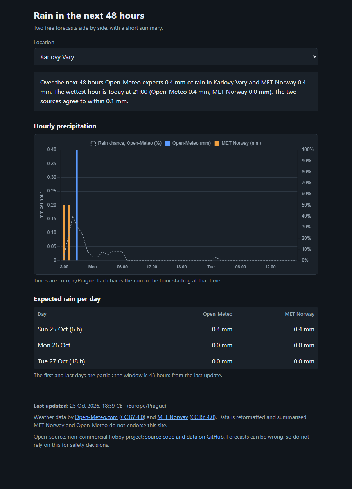
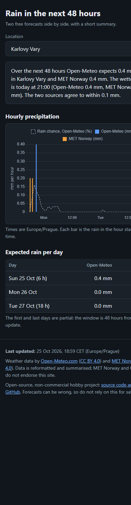
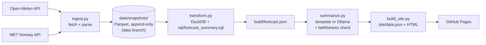

# rain-forecast-cz

**A small, fully static website that shows the next 48 hours of rain for five Czech cities, putting two free forecasts (Open-Meteo and MET Norway) side by side with a short plain-language summary.** An hourly GitHub Actions job fetches both APIs, stores every forecast it ever saw as Parquet, builds the numbers with DuckDB SQL, writes the summaries, and publishes plain HTML to GitHub Pages. There is no server and no per-visitor computation.

It is phase 1 of a personal learning project (Python, SQL, later PySpark). The long-term idea is to keep the forecast history and eventually check which source was right.

**Live site:** `https://<your-user>.github.io/<your-repo>/` (see [Deploy your own](#deploy-your-own))

| Desktop | Phone |
| --- | --- |
|  |  |

> The screenshots come from a local build. Replace them with ones from the live site once it is deployed.

## How it works



| Step | File | What it does |
| --- | --- | --- |
| 1 | `src/ingest.py` (+ `src/parsers.py`) | Calls both APIs for every location in `config/locations.yaml`, parses them to hourly rows, writes a **new** Parquet file per source per run. One failing source or city never stops the run. |
| 2 | `src/transform.py` + `sql/forecast_summary.sql` | DuckDB picks the newest snapshot per source and city, joins the two sources hour by hour, and computes the 48-hour window, daily totals, wettest hours and the difference between sources. |
| 3 | `src/summarize.py` | Writes 2 to 3 sentences per city from the computed facts only. `template` (default) or `ollama` (local LLM). |
| 4 | `src/build_site.py` + `web/` | Writes `site/data.json` and copies the static page (vanilla JS + Chart.js from a CDN). |

Snapshot layout, ready for a later job to join against observations:

```
data/snapshots/source=open-meteo/date=2026-10-25/part-20261025T175756Z.parquet
data/snapshots/source=met-no/date=2026-10-25/part-20261025T175756Z.parquet
data/cache/met_state.json          # MET Norway Expires / Last-Modified bookkeeping
```

Each row is one forecast hour as predicted at `fetched_at`: `location, lat, lon, valid_time, hour_start, precip_mm, precip_prob, temp_c, source_updated_at` (the schema is `SCHEMA` in `src/ingest.py`).

## Tech stack

Python 3.11+, [DuckDB](https://duckdb.org/) (SQL), PyArrow (Parquet), requests, PyYAML, pytest, [Chart.js](https://www.chartjs.org/) (CDN, pinned version with SRI hash), GitHub Actions and GitHub Pages. Optional: [Ollama](https://ollama.com/) for local LLM summaries. Dependencies are pinned in `requirements.txt`.

## Run it locally

```bash
python -m venv .venv
source .venv/bin/activate            # Windows PowerShell: .venv\Scripts\Activate.ps1
pip install -r requirements.txt
cp .env.example .env                 # then edit USER_AGENT and REPO_URL
```

MET Norway requires a descriptive `User-Agent` of the form `<project-name>/<version> <repo URL>` and blocks anonymous clients. Put yours in `.env` (in CI it comes from a repository variable, see below). The public repo URL is the contact, so no personal email is needed.

Run the steps one at a time:

```bash
python -m src.ingest                                   # fetch everything, write data/snapshots/...
python -m src.ingest --source met-no --location Praha  # or just one source and one city
python -m src.transform                                # DuckDB SQL -> build/forecast.json
python -m src.summarize                                # -> build/summaries.json
python -m src.build_site                               # -> site/
python -m http.server 8000 --directory site            # open http://localhost:8000
python -m pytest -q                                    # tests
```

Look at the snapshots yourself with DuckDB:

```sql
SELECT source, location, count(*) AS rows, max(fetched_at) AS last_fetch
FROM read_parquet('data/snapshots/*/*/*.parquet', hive_partitioning = true)
GROUP BY ALL;
```

### Switch to the Ollama summarizer

1. Install [Ollama](https://ollama.com/download) and pull a small model: `ollama pull llama3.2:3b`
2. Make sure it is running (`ollama serve`, listening on `http://localhost:11434`).
3. Run the summarize step with the environment variable set (or change `summarizer:` in `config/settings.yaml`):

```bash
SUMMARIZER=ollama python -m src.summarize          # PowerShell: $env:SUMMARIZER = "ollama"
```

The model name and URL live under `ollama:` in `config/settings.yaml`. The model only receives the computed facts as JSON, is told to describe and never speculate, and its answer is rejected if any number in it is not in the facts (it then falls back to the template text). The site shows an "AI-generated" label only for summaries the LLM actually wrote. If Ollama is not running, the template summaries are used instead (a warning is logged).

## Deploy your own

1. Create a **public** GitHub repository and push this code to `main`.
2. **Settings → Pages → Source: GitHub Actions.**
3. **Settings → Secrets and variables → Actions → Variables**, add:
   - `USER_AGENT` = `rain-forecast-cz/0.1 https://github.com/<you>/<repo>`
   - `REPO_URL` (optional; defaults to the repository's own URL)
4. **Actions → Update forecast → Run workflow** once. After that it runs hourly at minute 23.

The workflow (`.github/workflows/update-forecast.yml`) runs ingest, transform, summarize (template mode), and build, commits the new snapshots to the `data` branch, and deploys `site/` to Pages.

### Where the data is stored (and the tradeoff)

Snapshots are committed to a separate `data` branch, never to `main`. That is free and needs no database, and anyone can clone the branch and query the history with DuckDB. The tradeoff: git is not built for ever-growing binary data. Every run adds a few small files (about 10 KB for 5 cities and 2 sources, so roughly 100 MB per year), and git history keeps all of it forever, so clones get slower over time.

When the branch grows large, compact it:

- **Weekly compaction:** merge each completed `source=…/date=…/` folder into a single Parquet file (DuckDB's `COPY (SELECT * FROM read_parquet(...)) TO ... (FORMAT parquet)` does this in one statement), then commit.
- **Reset the history:** squash the `data` branch to a single commit (`git checkout --orphan`, re-add, force-push). The files stay, the old commits go.
- **Or move the files out of git** to object storage (S3, R2, Azure Blob) or GitHub Releases, and keep only the pipeline in the repo.

### GitHub pauses scheduled workflows after 60 days of inactivity

In a public repository GitHub **automatically disables scheduled workflows when there has been no repository activity for 60 days**. Commits made by the workflow itself to the `data` branch may not count, so the site can quietly stop updating. To re-enable: open the **Actions** tab, choose **Update forecast**, and click **Enable workflow** (or make any commit to `main`). Running it manually with **Run workflow** also works.

## Data, licenses, and non-commercial use

- Code: MIT, see [`LICENSE`](LICENSE).
- Data: Open-Meteo and MET Norway, both CC BY 4.0, see [`DATA_LICENSES.md`](DATA_LICENSES.md). The attribution is shown in the site footer and travels with the snapshots on the `data` branch.
- **This is a non-commercial project.** The site has no ads, no tracking and no monetization, because Open-Meteo's free tier is for non-commercial use only. Please keep it that way if you fork it (or switch to a paid plan).
- Request volume is tiny: a few calls per hour, far below Open-Meteo's free limits. For MET Norway the pipeline truncates coordinates to 4 decimals, sends the `User-Agent` from `USER_AGENT`, does not call again before the `Expires` time, and sends `If-Modified-Since`.

## What I learned / what's next

**Phase 1 (this repo):** a working batch pipeline from two APIs to a static site, with an append-only history of forecasts. Things that taught me something:

- The two APIs disagree about what a timestamp means: Open-Meteo labels an hour by its *end*, MET Norway by its *start*. `src/parsers.py` shows how to put them on one `hour_start` axis, and a test pins this down.
- Joining sources with a `FULL OUTER JOIN` so one missing source degrades the page instead of breaking it.
- Respecting an API's cache rules (`Expires`, `If-Modified-Since`) across stateless CI runs by storing a small state file next to the data.
- Keeping an LLM honest: give it only computed facts, then verify its output mechanically instead of trusting it.

**Roadmap:**

1. **Score the forecasts.** Download observed rainfall (ČHMÚ station data) and join it with the snapshot history: how wrong was each source, for which lead time (the 3-hour-ahead forecast versus the 40-hour-ahead one)? The `fetched_at` and `hour_start` columns exist for exactly this.
2. **Correction model.** Train a small model on that history to correct systematic bias and show it as a third line.
3. Radar data for the next hours, and moving the heavy history processing to PySpark once it is large enough to justify it.

### Where to start reading the SQL

Open `sql/forecast_summary.sql` and read it top to bottom: `latest_snapshot` (newest forecast per source), then `hourly` (the FULL OUTER JOIN and the time-window filter), then `daily` and `peak_hours`. `tests/test_transform.py` shows each piece on tiny hand-made data.
