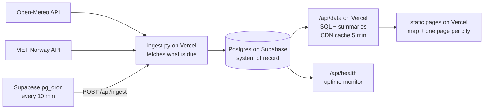

# rain-forecast-cz

**A small website with a map of Czechia that shows the rain chance and temperature for the 13 regional capitals over the next 48 hours, putting two free forecasts (Open-Meteo and MET Norway) side by side. Tap a city for a quick view with a short plain-language summary, or open its full page.** Supabase calls a small Python app on Vercel every 10 minutes; it fetches whatever is due from both APIs and stores every forecast it ever saw in a Postgres database (Supabase). The pages are static files on Vercel; the numbers come from `/api/data`, which builds them with SQL and is cached by the CDN for 5 minutes.

It is phase 1 of a personal learning project (Python, SQL, later PySpark). The long-term idea is to keep the forecast history and eventually check which source was right.

**Live site:** `https://<your-project>.vercel.app/` (see [Deploy your own](#deploy-your-own))

| Map | Quick view | City page | Phone |
| --- | --- | --- | --- |
|  |  |  |  |

> The screenshots come from a local build. Replace them with ones from the live site once it is deployed.

## How it works



| Step | File | What it does |
| --- | --- | --- |
| 1 | `src/ingest.py` (+ `src/parsers.py`), called by `POST /api/ingest` | Calls both APIs for every location in `config/locations.yaml` **when they are due**, parses them to hourly rows and stores one row per source and place in Postgres. MET Norway is polled by its `Expires` header, Open-Meteo at most every `open_meteo_min_interval_minutes` (55) per place, so most 10-minute calls make no API request at all. One failing source or city never stops the run. |
| 2 | `src/transform.py` + `sql/forecast_summary.sql` | PostgreSQL picks the newest fetch per source and city, joins the two sources hour by hour, and computes the 48-hour window, daily totals, wettest hours, temperatures and the difference between sources. |
| 3 | `src/summarize.py` | Writes 2 to 3 sentences per city from the computed facts only. `template` (default, used on the server) or `ollama` (local LLM, for local runs). |
| 4 | `src/service.py` + `src/web_app.py` | `GET /api/data` runs steps 2 and 3 on request and returns the JSON the pages draw. The CDN caches it for 5 minutes (`s-maxage=300`), so the database is hit at most once per period. "Last updated" is the time of the newest fetch, not the time of the request. |
| 5 | `src/build_site.py` + `web/` | Builds the static page shell (`index.html` and one page per city from `web/city.html`, no database needed). Vanilla JS, [MapLibre GL](https://maplibre.org/) with [OpenFreeMap](https://openfreemap.org/) tiles for the map and Chart.js for the charts, both from a CDN. The page draws the real sky from the Open-Meteo sky fields: `web/scene.js` turns an hour (or day) of data into one "scene" (weather type, cloud layers, rain, snow, fog, wind, daylight from sunrise/sunset), which drives the markers, the map colours (towns light up at night) and the weather animation (`web/fx.js`). Theme is Auto (follows daylight) / Light / Dark; an hour slider scrubs the forecast. While a page is open it checks for newer data every 5 minutes and offers a refresh. |
| 6 | `src/monitor.py` | `GET /api/health` answers 503 when a source has had no new data for too long. Point an uptime monitor (UptimeRobot, Better Stack) at it and it e-mails you. |

**The database** (`db/migrations/`, schema `rain`):

| Table / view | What it holds |
| --- | --- |
| `rain.fetches` | One row per source, location and download time. The hourly values are arrays starting at `first_hour`: `precip_mm`, `precip_prob`, `temp_c`, and, **from Open-Meteo only**, cloud cover (total and low/mid/high), `is_day`, `sunshine_s`, `weather_code` (WMO), `visibility_m`, `humidity_pct`, `wind_ms`, `gust_ms`, `wind_dir_deg`, plus `sunrise` / `sunset` per day. The new values are NULL for MET Norway and for fetches made before they were collected (migration `002`). |
| `rain.forecast_hours` | A view that unpacks `fetches` to one row per forecast hour. Use this for analysis. |
| `rain.locations` | Slug, name and coordinates of each place. |
| `rain.ingest_runs` | A log of every ingest call that stored or failed something: rows stored, failures. |
| `rain.http_state` | "Do not ask again before" times per polled API and place (MET Norway `Expires` / `Last-Modified`, Open-Meteo's own minimum interval). It replaces the old state file because the Vercel function has no disk (migration `003`). |

**History.** Postgres holds every fetch for now. The old Parquet snapshots on the `data` branch (written until the move to Vercel) are read by `src/legacy_parquet.py`; each row there is one forecast hour as predicted at `fetched_at`. When reading old and new Parquet files together, ask your tool to merge the columns by name (DuckDB: `read_parquet('data/snapshots/*/*/*.parquet', hive_partitioning = true, union_by_name = true)`). Open-Meteo is asked for everything in one request per place, in m/s for wind.

## Tech stack

Python 3.11+, PostgreSQL on [Supabase](https://supabase.com/) (free tier) with psycopg 3, FastAPI, requests, PyYAML, pytest, [MapLibre GL](https://maplibre.org/) + [OpenFreeMap](https://openfreemap.org/) map tiles, [Chart.js](https://www.chartjs.org/) (CDNs, pinned versions with SRI hashes), Vercel (static pages + a FastAPI function), Supabase pg_cron for the schedule, GitHub Actions for the tests. Optional: [Ollama](https://ollama.com/) for local LLM summaries. Dependencies are pinned in `requirements.txt` (what Vercel installs) and `requirements-dev.txt` (tests, local server, Parquet).

## Run it locally

```bash
python -m venv .venv
source .venv/bin/activate            # Windows PowerShell: .venv\Scripts\Activate.ps1
pip install -r requirements-dev.txt
cp .env.example .env                 # then edit USER_AGENT, REPO_URL and the database URLs
```

The pipeline needs a Postgres database (see [Set up the database](#set-up-the-database)). Put its connection string in `.env` as `DATABASE_URL`. Use a separate development database while you are experimenting, not the production one.

MET Norway requires a descriptive `User-Agent` of the form `<project-name>/<version> <repo URL>` and blocks anonymous clients. Put yours in `.env` (in CI it comes from a repository variable, see below). The public repo URL is the contact, so no personal email is needed.

Run the steps one at a time:

```bash
python -m src.ingest                                   # fetch what is due, store it in Postgres (--force: everything)
python -m src.ingest --source met-no --location Praha  # or just one source and one city
python -m src.build_site                               # the static page shell -> site/
uvicorn src.web_app:app --reload                       # /api/data, /api/health, /api/ingest on http://localhost:8000
python -m src.monitor                                  # is fresh data arriving?

# Without the app (a plain static preview): build the numbers into site/data.json and serve the folder
python -m src.transform && python -m src.summarize && python -m src.build_site --with-data
python -m http.server 8000 --directory site
python -m pytest -q                                    # tests
```

The database tests only run when `TEST_DATABASE_URL` points at a **throwaway** database (they drop and recreate the `rain` schema, and refuse to run against `DATABASE_URL`). Without it they are skipped. In CI a Postgres container is used.

Look at the history yourself, in the Supabase SQL editor or any Postgres client:

```sql
SELECT source, location_slug, count(*) AS fetches, max(fetched_at) AS last_fetch
FROM rain.fetches
GROUP BY 1, 2 ORDER BY 1, 2;
```

### Switch to the Ollama summarizer

1. Install [Ollama](https://ollama.com/download) and pull a small model: `ollama pull llama3.2:3b`
2. Make sure it is running (`ollama serve`, listening on `http://localhost:11434`).
3. Run the summarize step with the environment variable set (or change `summarizer:` in `config/settings.yaml`):

```bash
SUMMARIZER=ollama python -m src.summarize          # PowerShell: $env:SUMMARIZER = "ollama"
```

The model name and URL live under `ollama:` in `config/settings.yaml`. The model only receives the computed facts as JSON, is told to describe and never speculate, and its answer is rejected if any number in it is not in the facts (it then falls back to the template text). The site shows an "AI-generated" label only for summaries the LLM actually wrote. If Ollama is not running, the template summaries are used instead (a warning is logged).

## Deploy your own

You need free accounts at GitHub, [Supabase](https://supabase.com/) and [Vercel](https://vercel.com/).

1. Push this code to a GitHub repository. GitHub Actions only runs the tests (`.github/workflows/tests.yml`).
2. [Set up the database](#set-up-the-database) first (below), then:
3. **Vercel → Add New Project → import the repository.** `vercel.json` already sets the build command (`python -m src.build_site`) and the output folder (`site`). Add these **environment variables**:
   - `DATABASE_URL`: the `pipeline` role's connection string from the next section.
   - `USER_AGENT` = `rain-forecast-cz/0.1 https://github.com/<you>/<repo>` (MET Norway blocks anonymous clients).
   - `INGEST_SECRET`: any long random string. Only callers that send it can trigger `/api/ingest`.
   - `REPO_URL` (optional): shown in the page footer.
4. Deploy, then check `https://<your-project>.vercel.app/api/health` (503 until the first ingest has run is expected) and trigger the first ingest by hand:

```bash
curl -X POST -H "Authorization: Bearer <INGEST_SECRET>" https://<your-project>.vercel.app/api/ingest
```

5. **Schedule it**: apply `db/cron/ingest_schedule.sql` in the Supabase SQL editor (it enables `pg_cron` and `pg_net`, stores the secret in the Vault and calls `/api/ingest` every 10 minutes). `vercel.json` also has a once-a-day cron on the same endpoint as a safety net, because the free Vercel plan allows nothing more frequent.
6. Add an uptime monitor on `/api/health` (UptimeRobot, Better Stack: both have free plans) so you get an e-mail when data stops arriving.

Why Supabase and not GitHub Actions or Vercel Cron as the scheduler? GitHub's scheduled workflows are best effort: this project saw 4 runs in 20 hours instead of 20. Vercel Cron runs once a day on the free plan. `pg_cron` runs on time.

### Set up the database

1. Create a free project at [supabase.com](https://supabase.com/) (pick an EU region, set a strong database password and keep it in a password manager).
2. **Connect → Session pooler**: copy the connection string (host `aws-…pooler.supabase.com`, port **5432**, user `postgres.<project-ref>`). Use a *pooler*, not the direct connection: the direct one is IPv6-only on the free plan and Vercel only has IPv4. The transaction pooler (port 6543) works too; the code switches prepared statements off. Add `?sslmode=require`.
3. Put it in your local `.env` as `ADMIN_DATABASE_URL` (never in Vercel or GitHub, never committed), then:

```bash
python -m src.db_migrate                         # creates schema, tables, view, security rules
python -m src.db_migrate --create-pipeline-role  # prints the connection string of a limited `pipeline` role, once
```

4. Use that printed string as `DATABASE_URL` (Vercel environment variable, and your local `.env`). The `pipeline` role can read and add data but cannot change the table structure or delete history. The tables live in a schema that Supabase's public REST API does not expose, and row level security is on.
5. Old history: the Parquet snapshots on the `data` branch can be read with `src/legacy_parquet.py` (`list_files`, `fetches_from_file`). Keep the branch until they are archived.

The free plan **pauses a project after a week of low activity** and has **no automatic backups**. The 10-minute calls keep it active. Postgres is the only copy of the history, so keep the `data` branch until the archive job exists.

**Growth.** With only rain and temperature the database grew about 280 MB a year (measured: about 1.2 KB per fetch). The extra Open-Meteo arrays make an Open-Meteo fetch several times bigger, so expect roughly 400 to 570 MB a year for 13 places, and the 500 MB free tier would last about a year. Measure it with `SELECT pg_size_pretty(pg_total_relation_size('rain.fetches'));` and `SELECT avg(pg_column_size(f.*)) FROM rain.fetches f WHERE source = 'open-meteo';`. Keeping only a rolling window in the database and archiving the rest as Parquet files is the planned fix. The `pipeline` role cannot delete, so pruning needs a separate role.

### Monitoring

- Every ingest call that stores or fails something writes a row per source to `rain.ingest_runs`.
- `/api/health` fails (HTTP 503, with the reasons in the JSON) when a source has no new data for `monitor.alert_after_hours` (3 by default, in `config/settings.yaml`). Your uptime monitor turns that into an e-mail.
- To see whether the schedule fires, in the Supabase SQL editor: `SELECT * FROM cron.job_run_details ORDER BY start_time DESC LIMIT 10;` and `SELECT created, status_code, content FROM net._http_response ORDER BY created DESC LIMIT 10;`.
- The website shows an "outdated" banner when its data is older than `stale_banner_after_hours` (6). It is checked in the visitor's browser, so it also works when the whole pipeline has stopped.

### Long-term archive (Cloudflare R2)

Postgres keeps only the newest **15 days**. Every night `.github/workflows/archive.yml` runs `python -m src.archive`, which copies each finished UTC day older than 2 days to a Parquet file (zstd) in a Cloudflare R2 bucket, downloads the file again and compares its row count with Postgres, records the day in `rain.archive_log`, and only then deletes rows older than 15 days **for days that were verified**. This is the history for scoring forecasts and training a correction model. Total loss of the database costs at most the ~2 days that are not archived yet.

Layout (hive style, so DuckDB and Spark can prune on source and date; `source` and `date` come from the path, not from columns):

```
forecasts/source=open-meteo/date=2026-10-25/part.parquet     # date = UTC day of fetched_at
forecasts/source=met-no/date=2026-10-25/part.parquet
observations/date=2026-10-25/part.parquet                    # skipped while rain.observations does not exist
```

Forecast files hold long rows, one per forecast hour of one fetch: `location_slug, fetched_at, source_updated_at, hour_start, lead_hours` plus the hourly values (`precip_mm`, `temp_c`, `cloud_pct`, ...). `lead_hours` is the hours from `fetched_at` to `hour_start` (the first hour of a fetch is slightly negative, because it starts before the fetch).

**Set it up** (once; the free R2 plan has 10 GB and no egress fees, which is plenty):

1. In the Cloudflare dashboard create an R2 bucket and an **API token** (R2 → Manage API tokens, permission *Object Read & Write*, limited to that bucket). Note the account id, access key id and secret.
2. Apply the migration and create the `archiver` role with your admin connection (it can read and delete data, so keep its URL out of Vercel):

```bash
python -m src.db_migrate --create-archiver-role   # prints the archiver connection string once
```

3. Add these GitHub repository **secrets**: `ARCHIVE_DATABASE_URL` (that string), `R2_ACCOUNT_ID`, `R2_ACCESS_KEY_ID`, `R2_SECRET_ACCESS_KEY`, `R2_BUCKET`.
4. Try it without any R2 credentials, reading Postgres only (`pip install -r requirements.txt -r requirements-archive.txt` first):

```bash
ARCHIVE_DATABASE_URL=... python -m src.archive --dry-run            # what would be uploaded and deleted
ARCHIVE_DATABASE_URL=... python -m src.archive --local-dir archive  # write the files to a folder; nothing is logged or deleted
```

   Then run the workflow by hand (Actions → Archive to R2 → Run workflow, with *Dry run* ticked the first time).
5. Move the old history out of the `data` branch (needs no database, only `git fetch origin data` and the R2 variables):

```bash
python -m src.archive --from-data-branch --dry-run   # list the days it would convert
python -m src.archive --from-data-branch
```

   Only days before today are converted; a day that is already in R2 is skipped (`--force` overwrites). The nightly job later replaces a day with the Postgres version of the same data, but never with a smaller file.

**Read it with DuckDB** (an R2 secret needs your account id and the token above):

```sql
INSTALL httpfs; LOAD httpfs;
CREATE SECRET r2 (TYPE r2, KEY_ID '<access key id>', SECRET '<secret>', ACCOUNT_ID '<account id>');

-- every forecast ever archived; union_by_name copes with columns that were added later
SELECT * FROM read_parquet('r2://<bucket>/forecasts/*/*/part.parquet', hive_partitioning = true, union_by_name = true) LIMIT 10;

-- How wrong is each source's temperature forecast, by lead time? Measured at Praha-Ruzyně vs the forecast for Praha.
-- (Look the station id up in config/locations.yaml; the readings are every 10 minutes, so keep the full hours.)
WITH f AS (
    SELECT source, hour_start, temp_c AS forecast_c, round(lead_hours / 6) * 6 AS lead_bucket_h
    FROM read_parquet('r2://<bucket>/forecasts/*/*/part.parquet', hive_partitioning = true, union_by_name = true)
    WHERE location_slug = 'praha' AND lead_hours >= 0
), o AS (
    SELECT observed_at, temp_c AS measured_c
    FROM read_parquet('r2://<bucket>/observations/*/part.parquet', hive_partitioning = true, union_by_name = true)
    WHERE station_wsi = '0-20000-0-11518' AND date_part('minute', observed_at) = 0
)
SELECT source, lead_bucket_h, count(*) AS n, round(avg(abs(forecast_c - measured_c)), 2) AS mean_abs_error_c
FROM f JOIN o ON o.observed_at = f.hour_start
GROUP BY ALL ORDER BY source, lead_bucket_h;
```

Archiving the radar images (about 2.5 GB a year) is not done yet.

## Data, licenses, and non-commercial use

- Code: MIT, see [`LICENSE`](LICENSE).
- Data: Open-Meteo and MET Norway, both CC BY 4.0, see [`DATA_LICENSES.md`](DATA_LICENSES.md). The attribution is shown in the site footer. The database content is derived from the same data, so the same attribution applies to it.
- **This is a non-commercial project.** The site has no ads, no tracking and no monetization, because Open-Meteo's free tier is for non-commercial use only. Please keep it that way if you fork it (or switch to a paid plan).
- Map tiles come from OpenFreeMap (no key needed) and the Inter font from Google Fonts. The map shows the required attribution. Visitors' browsers request these directly, so those servers see their IP addresses.
- Request volume is tiny: about 13 calls per hour to each weather API (the 10-minute job only asks when something is due), far below Open-Meteo's free limits. For MET Norway the pipeline truncates coordinates to 4 decimals, sends the `User-Agent` from `USER_AGENT`, does not call again before the `Expires` time, and sends `If-Modified-Since`.

## What I learned / what's next

**Phase 1 (this repo):** a working batch pipeline from two APIs to a static site, with an append-only history of forecasts. Things that taught me something:

- The two APIs disagree about what a timestamp means: Open-Meteo labels an hour by its *end*, MET Norway by its *start*. `src/parsers.py` shows how to put them on one `hour_start` axis, and a test pins this down.
- Joining sources with a `FULL OUTER JOIN` so one missing source degrades the page instead of breaking it.
- Respecting an API's cache rules (`Expires`, `If-Modified-Since`) across stateless serverless calls by storing the "not before" times in a small database table.
- Keeping an LLM honest: give it only computed facts, then verify its output mechanically instead of trusting it.

**Roadmap:**

1. **Score the forecasts.** Download observed rainfall (ČHMÚ station data) and join it with the snapshot history: how wrong was each source, for which lead time (the 3-hour-ahead forecast versus the 40-hour-ahead one)? The `fetched_at` and `hour_start` columns exist for exactly this.
2. **Correction model.** Train a small model on that history to correct systematic bias and show it as a third line.
3. Radar data for the next hours, and moving the heavy history processing to PySpark once it is large enough to justify it.

### Where to start reading the SQL

Open `sql/forecast_summary.sql` and read it top to bottom: `latest_snapshot` (newest forecast per source, `DISTINCT ON`), then `hourly` (the FULL OUTER JOIN and the time-window filter), then `daily` and `peak_hours` (a window function). `db/migrations/001_init.sql` explains the table design and the `unnest` view. `tests/test_transform.py` shows each piece on tiny hand-made data (it needs `TEST_DATABASE_URL`).
